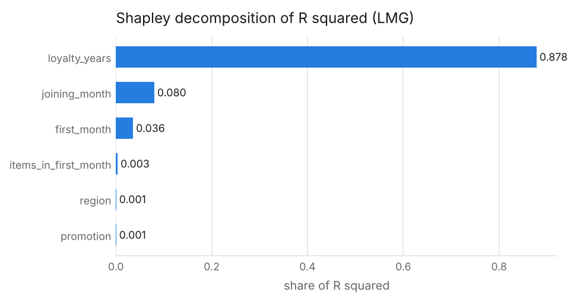
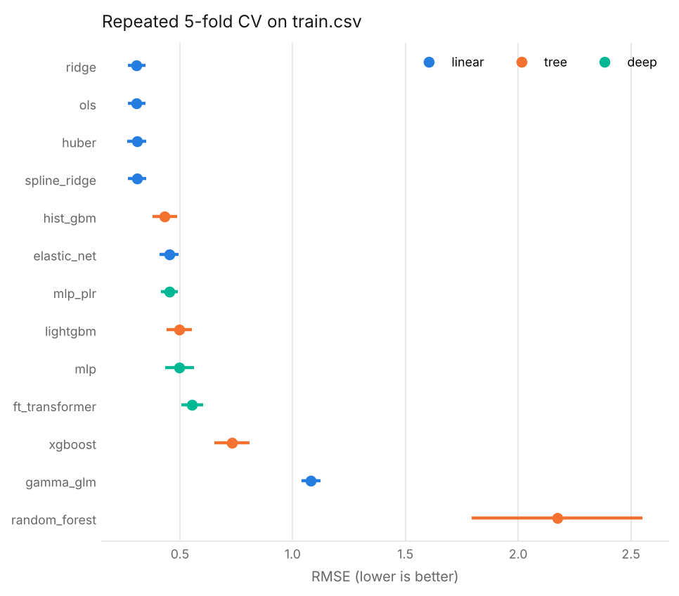
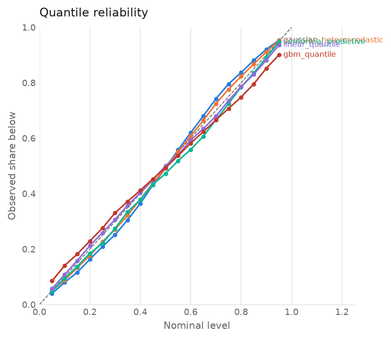
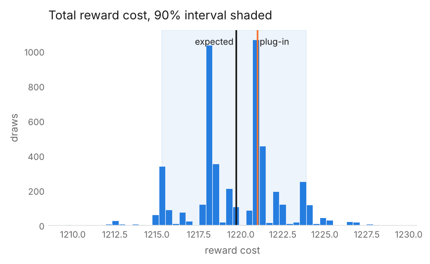
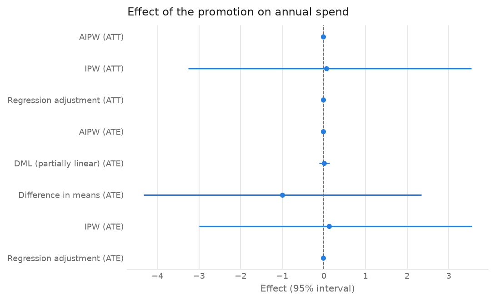

# Supermarket Loyalty: Spend Forecasting and Reward Cost Estimation

[](https://github.com/sahandyousefi/Supermarket-Loyalty-ML-Project/actions/workflows/ci.yml)


International Essentials, an international supermarket chain, pays loyalty rewards that grow with a member's annual spend. To budget for those rewards, the business needs a forecast of each member's spend, an honest statement of its uncertainty, and the resulting distribution of total reward cost.

This project answers that question end to end. It cleans and validates the raw extracts, tests the business hypothesis that tenure drives spend, compares fourteen models from linear regression to an FT-Transformer and a Gaussian process under a common statistical protocol, and uses a calibrated simulation study to show when each model family is worth its cost. It then builds prediction intervals that are checked for coverage within every subgroup, turns forecasts into a Monte Carlo distribution of reward cost, searches the tier thresholds, estimates the effect of the sign-up promotion and designs the randomised test that would settle it. Around the model sit the pieces a team would need to run it: data contracts and intake checks, drift tests and control charts, a scoring service, a model registry with a champion-challenger rule, reproducibility checks and a documentation site.

It started as a certification exercise (the original notebook is kept in `notebooks/`) and is now a typed, tested Python package with a command line interface.

## Contents

- [Key findings](#key-findings)
- [Results](#results)
- [Approach](#approach)
- [Project structure](#project-structure)
- [Getting started](#getting-started)
- [Testing and CI](#testing-and-ci)
- [Runtime](#runtime)
- [Limitations](#limitations)
- [References](#references)

## Key findings

1. **Tenure is the dominant driver of spend, but not monotonically.** In `loyalty.csv`, tenure band explains 88% of the variance accounted for by all features (Shapley decomposition of R squared). Welch's ANOVA gives F = 2506 on (4, 483) df with omega squared 0.885 (95% interval 0.876 to 0.894), and the effect survives adjustment for region, joining month and promotion (Freedman-Lane permutation p = 0.0005, the smallest attainable with 2,000 permutations). Spend peaks in the 5-10 year band (mean 135.15) and falls for members of 10 years or more (117.41), so "longer tenure means higher spend" is not supported as stated.
2. **The supplied files cannot be joined.** `train.csv` and `loyalty.csv` share all customer ids, but region, tenure, joining month and promotion agree no more often than chance (Cohen's kappa between -0.004 and 0.052). Joining them on `customer_id` would silently corrupt every feature.
3. **On the supplied data, a linear model is the right choice.** OLS reaches a cross-validated RMSE of 0.308 against a target standard deviation of 26.8 (R squared 0.9999). Every non-linear model, including gradient boosting and three neural networks, is significantly worse (corrected resampled t-test, p < 0.001).
4. **Flexible models win only when the data demand them.** In a simulation calibrated to the real feature distribution, gradient boosting cuts the excess error over the irreducible noise from 2.6 times to 0.11 times the Bayes error once interactions are present. A plain MLP trails, and periodic numeric embeddings close most of that gap.
5. **Point forecasts misstate reward cost.** Rewards jump at tier thresholds, so the expected cost differs from the cost of the expected spend. For the 250 customers in `test.csv` the Monte Carlo forecast gives an expected total of 1,219.7 with a 90% interval of [1,215.3, 1,223.9], against 1,221.0 from plugging in point forecasts.
6. **The sign-up promotion has no detectable effect on spend.** Members who joined through the promotion spend 0.99 less on average, but the difference disappears once region, joining month and tenure are accounted for: augmented IPW gives -0.015 with a 95% interval of [-0.056, 0.026], on a mean spend of about 120. Effects larger than 0.06 in either direction are ruled out under unconfoundedness.
7. **Uncertainty depends on when a member joined, and the champion now models it.** Forecast errors are five times larger for August joiners than for June joiners, and the spread of a cohort's first-month spend predicts how large they will be. A weighted least squares model with one error variance per joining month forecasts as well as OLS but gives 90% intervals that are on target in all twelve months instead of eight, with a 12% lower interval score; it replaced OLS as the champion under a rule that promotes a model for better intervals only if its accuracy is not worse.
8. **A randomised test of the promotion would be cheap.** Because the attributes known at sign-up explain 99.99% of the variance in spend, an adjusted analysis detects an effect of 0.1 with about 150 members per arm, where a raw comparison would need more than a million. A four-look group-sequential design keeps the type I error at 5% and stops early in most trials when the effect is real.

## Results

All figures below are produced by `loyalty-spend report`; the full tables are in [reports/results.md](reports/results.md).

### Spend by tenure (Task 2)

| Tenure | n | Mean spend | Variance | 95% bootstrap CI |
| --- | --- | --- | --- | --- |
| 0-1 | 382 | 110.56 | 9.30 | [110.26, 110.86] |
| 1-3 | 241 | 129.31 | 9.65 | [128.91, 129.72] |
| 3-5 | 256 | 124.55 | 11.09 | [124.15, 124.96] |
| 5-10 | 250 | 135.15 | 14.10 | [134.70, 135.61] |
| 10+ | 117 | 117.41 | 16.72 | [116.63, 118.12] |

All ten pairwise differences are significant under Tukey's HSD and under the Games-Howell procedure, which does not pool the unequal band variances.

<p>
  
  
</p>

### Model comparison on train.csv (Tasks 3 and 4)

Five-fold cross-validation repeated three times, identical splits for every model.

| Model | Family | RMSE | MAE | Difference to OLS | p-value |
| --- | --- | --- | --- | --- | --- |
| OLS | linear | 0.308 (0.040) | 0.215 | | |
| Ridge | linear | 0.308 (0.040) | 0.215 | -0.000 | 0.85 |
| Huber | linear | 0.309 (0.041) | 0.213 | 0.001 | 0.68 |
| Spline ridge | linear | 0.310 (0.041) | 0.216 | 0.002 | 0.27 |
| Gaussian process, linear plus ARD kernel | kernel | 0.310 (0.042) | 0.216 | 0.002 | 0.33 |
| Histogram GBM | tree | 0.433 (0.053) | 0.297 | 0.125 | < 0.001 |
| Elastic net | linear | 0.452 (0.042) | 0.322 | 0.144 | < 0.001 |
| MLP, periodic embeddings | deep | 0.454 (0.037) | 0.341 | 0.145 | < 0.001 |
| LightGBM | tree | 0.497 (0.055) | 0.350 | 0.189 | < 0.001 |
| MLP, entity embeddings | deep | 0.499 (0.065) | 0.372 | 0.190 | < 0.001 |
| FT-Transformer | deep | 0.555 (0.047) | 0.424 | 0.246 | < 0.001 |
| XGBoost | tree | 0.731 (0.078) | 0.513 | 0.423 | < 0.001 |
| Gamma GLM | linear | 1.081 (0.041) | 0.817 | 0.773 | < 0.001 |
| Random forest | tree | 2.173 (0.379) | 1.316 | 1.865 | < 0.001 |

Standard deviation across folds in parentheses; p-values from the corrected resampled t-test. The target is almost an exact linear function of tenure, joining month and first-month spend. Tree ensembles approximate the linear effect of first-month spend with steps, and networks fit it only approximately, so both pay a small but significant price. The Gamma GLM's log link imposes multiplicative effects where the true effects are additive. The Gaussian process puts almost all of its variance into the linear part of its kernel: the fitted RBF amplitude sits at its lower bound, so the data offer no smooth interaction for it to find.



### Simulation study

Because the real data are nearly noise free, they cannot show when a flexible model is worth its cost. The simulator resamples real feature rows, uses the OLS fit as the base signal and adds controlled departures. Each model's RMSE is compared with the known Bayes error (2,000 customers, 5-fold CV).

| Model | Linear | Noisy, heteroscedastic | Nonlinear | Interactions |
| --- | --- | --- | --- | --- |
| OLS | **1.352** | **5.629** | 1.766 | 4.883 |
| Spline ridge | 1.358 | 5.642 | 1.655 | 4.819 |
| Histogram GBM | 1.466 | 6.108 | 1.507 | 1.529 |
| LightGBM | 1.464 | 6.041 | **1.474** | **1.486** |
| MLP | 1.490 | 5.888 | 1.738 | 1.791 |
| MLP, periodic embeddings | 1.465 | 5.886 | 1.559 | 1.602 |
| Bayes error | 1.341 | 5.485 | 1.341 | 1.341 |

The ranking follows the data-generating process: OLS is within 1% of the Bayes error when the truth is linear, and LightGBM is within 11% when it is not. The plain MLP has difficulty with the step in first-month spend, a known weakness of networks biased towards smooth functions (Grinsztajn et al., 2022). Periodic embeddings of the numeric inputs (Gorishniy et al., 2022) cut its excess error by 42 to 45% in the nonlinear and interaction scenarios.


### Prediction intervals

Simulated heteroscedastic scenario, 90% target coverage, evaluated on 5,000 new customers.

| Method | Coverage | Mean width | Worst decile |
| --- | --- | --- | --- |
| Split conformal (OLS) | 0.899 | 17.4 | 0.840 |
| Conformalized quantile regression (gradient boosting) | 0.896 | 20.1 | 0.840 |

Both methods meet the marginal target. Split conformal uses one width for everyone, so it over-covers low spenders (99% in the lowest decile) and under-covers high spenders (84 to 85% in the top two deciles). CQR stays closer to the target in the upper deciles (88% and 86%) but dips to 84% in the third decile, and its intervals are wider, since its quantile models are fitted on only 1,500 rows. At this sample size and level of heteroscedasticity, neither method dominates.


On the real members of `train.csv`, cross-fitted intervals audited by tenure band, region and joining month tell a different story (`loyalty-spend intervals --audit`):

| Method | Coverage | Mean width | Levels with coverage off target | Worst level |
| --- | --- | --- | --- | --- |
| Split conformal | 0.907 | 0.952 | 5 of 21 | August joiners, 0.707 |
| Mondrian on tenure band | 0.910 | 1.060 | 5 of 21 | August joiners, 0.733 |
| Localised, kernel weights | 0.913 | 0.999 | 4 of 21 | August joiners, 0.747 |
| Mondrian on joining month | 0.920 | 1.083 | 0 of 21 | August joiners, 0.893 |
| Normalized conformal | 0.915 | 1.007 | 0 of 21 | November joiners, 0.841 |

Levels are flagged by an exact binomial test after Benjamini-Hochberg adjustment. Errors depend on the month a member joined, so only methods that can see the month restore coverage within months; normalized conformal does so with the best interval score.

### Predictive distributions

Budgeting needs each customer's whole spend distribution, not one interval. Five forecasters are scored on the same heteroscedastic scenario with the continuous ranked probability score (CRPS) on a grid of 19 quantile levels (5-fold CV, 2,000 customers), and the interval methods are compared on 5,000 new customers. Coverage by group uses quintiles of predicted spend.

| Forecaster | CRPS | Difference to Gaussian | p-value | 90% coverage | PIT uniformity p |
| --- | --- | --- | --- | --- | --- |
| Linear quantile regression | 3.048 | -0.056 | 0.091 | 0.884 | 0.757 |
| Heteroscedastic Gaussian | 3.062 | -0.042 | 0.020 | 0.901 | < 0.001 |
| Conformal predictive distribution | 3.090 | -0.014 | 0.356 | 0.888 | 0.352 |
| Gaussian, constant variance | 3.104 | | | 0.909 | < 0.001 |
| Gradient boosting quantiles | 3.180 | 0.076 | 0.146 | 0.826 | < 0.001 |

| Interval method | Coverage | Mean width | Interval score | Worst quintile | Best quintile |
| --- | --- | --- | --- | --- | --- |
| Split conformal | 0.910 | 17.98 | 25.49 | 0.857 | 0.987 |
| Mondrian, prediction bins | 0.908 | 17.73 | 24.55 | 0.898 | 0.923 |
| Normalized conformal | 0.900 | 18.91 | 26.20 | 0.880 | 0.926 |
| CQR | 0.888 | 19.68 | 27.97 | 0.850 | 0.910 |

Modelling the variance lowers CRPS significantly, but the Gaussian shape is wrong for this scenario's heavy-tailed noise: both Gaussian models fail the PIT uniformity test, while linear quantile regression and the conformal predictive distribution pass it. Uncalibrated gradient-boosting quantiles are too narrow on 2,000 rows and cover only 83%. Among the intervals, calibrating within bins of predicted spend (Mondrian) keeps every quintile between 90% and 92%, where split conformal ranges from 86% to 99%, and it also has the best interval score.



### Reward cost

With the illustrative schedule in `configs/default.yaml` (2% from 100, 3% from 125, 5% from 140 of annual spend):

| Expected total | Plug-in total | 5th percentile | Median | 95th percentile |
| --- | --- | --- | --- | --- |
| 1,219.71 | 1,220.98 | 1,215.30 | 1,219.74 | 1,223.90 |

The distribution is lumpy because a handful of customers sit close to a tier threshold, and each of them moves the total by a discrete amount when they cross it. `loyalty-spend rewards` lists these customers with their probability of changing tier.

The forecast errors are larger for some joining months than for others. Drawing each member's error at the scale of their month (`--uncertainty month`) leaves the expected cost within 0.1% of the residual bootstrap; the same five members near a threshold carry most of the uncertainty either way.



### Effect of the sign-up promotion

The covariates are the attributes fixed at sign-up (region, joining month, tenure band); first-month spend is measured after joining and is left out because it may itself respond to the promotion. 494 of the 996 members in `train.csv` joined through the promotion.

| Estimator | Estimand | Estimate | Std. error | 95% interval |
| --- | --- | --- | --- | --- |
| Difference in means | ATE | -0.994 | 1.700 | [-4.326, 2.339] |
| Regression adjustment | ATE | -0.017 | 0.020 | [-0.055, 0.020] |
| IPW (Hajek) | ATE | 0.124 | 1.616 | [-2.995, 3.553] |
| Augmented IPW | ATE | -0.015 | 0.021 | [-0.056, 0.026] |
| Double ML, partially linear | ATE | 0.009 | 0.064 | [-0.116, 0.134] |
| Augmented IPW | ATT | -0.016 | 0.023 | [-0.060, 0.028] |

Overlap is good (propensities between 0.24 and 0.68) and weighting brings every standardized mean difference to 0.011 or less. The outcome models explain almost all of the variance in spend, which is why the estimators that use them are about 80 times more precise than weighting alone. On simulated data with strong confounding, the same estimators recover a known effect that the naive comparison overstates by a factor of two (see `tests/test_causal_analysis.py`). The robustness value of the regression estimate is 0.027: a confounder would need to explain 2.7% of the residual variance of both promotion uptake and spend to move the estimate to zero, but since the estimate is already indistinguishable from zero the more useful statement is the interval itself.



### Does the promotion work for anyone?

An average effect of zero could hide members who gain and members who lose. A DR-learner (Kennedy, 2023) predicts each member's effect; its predictions are tested with the best linear predictor and sorted group effects of Chernozhukov, Demirer, Duflo and Fernandez-Val (2018), over ten random splits that train on one half of `train.csv` and evaluate on the other.

| Group by predicted effect | Members | Predicted | Estimated (doubly robust) | Std. error |
| --- | --- | --- | --- | --- |
| 1 (largest) | 99 | 0.275 | -0.019 | 0.077 |
| 2 | 100 | 0.088 | -0.051 | 0.052 |
| 3 | 99 | -0.012 | 0.010 | 0.059 |
| 4 | 100 | -0.118 | 0.004 | 0.061 |
| 5 (smallest) | 100 | -0.314 | 0.017 | 0.070 |

The heterogeneity loading is -0.058 (se 0.164, p = 1.0): the predicted differences between members do not show up in held-out data, and targeting the half with the largest predicted effect is worth -0.014 per member [-0.052, 0.024]. On simulated data where the effect does vary with tenure, the same procedure detects it (p < 0.0001) and the targeted rule beats offering the promotion to everyone. An earlier version that cross-fitted the proxy and the scores on the full sample reported significant heterogeneity here; the effect was an artefact of shared training data and disappears with sample splitting.


### Reward programme design

`loyalty-spend design` costs the schedule for the 250 customers in `test.csv` on 5,000 draws from the heteroscedastic Gaussian model, then looks for alternatives.

| Question | Answer |
| --- | --- |
| Expected cost of the current schedule | 1,218.42, which is 3.79% of expected spend |
| 95% value at risk / expected shortfall | 1,223.47 / 1,224.36 |
| Cost change per unit increase of the 140 threshold | -22.59 (s.e. 0.03) |
| Cost change per unit increase of the 125 threshold | -0.97 |
| Same rates applied marginally (tax-bracket style) | 218.59 |
| Cost if members within 5 of a threshold close half of the gap | +59.97 (+4.9%), with 49.53 of extra spend |
| Cheapest schedule with the same reach and no more risk | thresholds 100, 135, 150: 917.54 (-24.7%) |

Almost all of the cost sensitivity sits at the top threshold, where many customers are predicted to land. Moving it from 140 to 150 leaves the share of members who earn a reward unchanged (80.8%), because no customer is predicted between 94 and 110, and cuts the expected cost by a quarter. The behavioural scenario is a stress test, not an estimate: the data cannot tell how members respond to a threshold, but it bounds what a whole-spend schedule could cost if they do, and a marginal schedule has no such exposure.

### Hierarchical Bayesian model

`loyalty-spend bayes` fits spend with partially pooled region effects by Gibbs sampling (four chains, 1,000 kept draws each). Every parameter has split R-hat at most 1.002 and an effective sample size above 1,600.

| Variant | WAIC | Effective parameters | Posterior predictive p-values |
| --- | --- | --- | --- |
| Normal errors | 497.2 | 27.5 | 0.37 to 0.91 |
| Student-t errors, nu = 4 | 263.4 | 22.9 | 0.01 to 0.85 |
| Normal errors, variance by tenure band | 470.5 | 34.9 | 0.12 to 0.88 |
| Normal errors, variance by joining month, pooled scale | 103.3 | 44.1 | |
| Student-t errors, variance by joining month, pooled scale | 55.4 | 33.3 | |

Lower WAIC is better: heavy-tailed errors fit the residuals far better than normal ones, but most of that gain comes from the joining months with larger errors. Giving each month its own variance, pooled towards a scale learned from the data, does more, and combined with Student-t errors it fits best. Every region effect lies within 0.06 of the average of the four, and all four 90% intervals include zero. Because only four regions inform the between-region scale, its posterior is set by the prior, which the prior sensitivity analysis makes explicit. With parameter uncertainty included, the reward cost of `test.csv` has a mean of 1,219.32 and a 90% interval of 1,215.03 to 1,223.91.

### Error variance by joining month

Forecast errors are five times larger for August joiners (residual SD 0.551) than for June joiners (0.104); the Brown-Forsythe and Koenker-Breusch-Pagan tests reject equal variances across months at p < 10^-6, while neither finds a difference across regions or the promotion. Across months, the error SD tracks the within-month SD of first-month spend almost one for one (Spearman 0.87), so a new cohort's first month already signals how predictable its annual spend will be: predicting a held-out month's error SD from its first-month spread lowers the mean interval score from 1.43 to 1.23 compared with the pooled SD.

| Cross-fitted on train.csv | RMSE | Mean width of 90% interval | Interval score | Months with coverage off target |
| --- | --- | --- | --- | --- |
| OLS, one error variance | 0.310 | 0.992 | 1.408 | 4 of 12 |
| Weighted least squares, variance per month | 0.309 | 0.905 | 1.233 | 0 of 12 |

### Explanations and what would change a tier

| Check | Result |
| --- | --- |
| Permutation importance, mean over 5 folds (RMSE increase) | tenure band 37.55, joining month 5.94, first-month spend 0.19, basket size 0.02, region and promotion 0.00 |
| Agreement of the importance ranking across folds (Kendall's W) | 0.973 |
| Fidelity of a surrogate tree to the champion, depth 2 / 3 / 4 | 0.964 / 0.991 / 0.998 |
| Customers in `test.csv` below the top tier | 122 of 250 |
| ... who could reach the next tier with a first-month spend inside the observed range | 0 |

A depth-3 tree reproduces 99.1% of the variance of the champion's forecasts using only tenure band and first-month spend, so the forecast is close to a lookup by tenure with a small adjustment for early spend. The counterfactual result follows from the same structure: first-month spend moves the forecast too little to cross a threshold, so for these customers the reward tier is effectively fixed at sign-up by tenure. The ALE and centred ICE curves of the gradient-boosting challenger (`reports/figures/ale_numeric.png`, `ice_first_month.png`) agree: first-month spend has a smooth effect with a range of about 6.5, and the centred curves are nearly parallel (interaction strength 0.09).

### Customer segments

Members of `loyalty.csv` are clustered with k-medoids on Gower distances over all recorded attributes, and every segment is checked by bootstrap.

| Segments | Average silhouette | Smallest segment |
| --- | --- | --- |
| 2 | 0.188 | 617 |
| 4 | 0.148 | 270 |
| 6 | 0.214 | 154 |
| 8 | 0.323 | 137 |

The best partition (8 segments) is essentially the grid of region by promotion uptake, every segment has a mean bootstrap Jaccard similarity between 0.47 and 0.72, below the 0.75 that marks a stable cluster, and mean spend differs by at most 6 between segments. The recorded attributes do not contain natural customer groups, so the segment tables in `loyalty-spend segments` are descriptive only; useful marketing segments would need behavioural data.

### Robustness

`loyalty-spend robustness` examines the OLS champion on `train.csv` with out-of-fold predictions, synthetic damage to the inputs, influence diagnostics and a learning curve.

| Check | Result |
| --- | --- |
| Slices of one or two attributes flagged after FDR control at 5% | 0 of 263 |
| Worst subgroup: joined in August (75 members) | RMSE 0.547 [0.416, 0.708], 1.77 times overall |
| Best subgroups: joined in June / April | 0.33 / 0.38 times overall |
| 20% relative noise on amounts / 20% amounts missing | RMSE 1.66 / 1.20 times clean |
| 5% of categories missing / replaced by an unseen level | RMSE 21 / 27 times clean |
| Largest Cook's distance | 0.066 (53 members above 4/n) |
| Learning curve, 80 / 319 / 797 training members | RMSE 0.370 / 0.318 / 0.308 |
| Change in mean forecast spend on `loyalty.csv` when imputed first-month amounts shift by 6 | 0.04 on 127.8 |

Accuracy differs by joining month and by little else, and no combination of attributes is forecast worse than chance alone would explain. The model degrades gracefully when amounts are noisy or missing, but a missing or unrecognised tenure band removes almost all of the signal for that member, so the contract check on that column matters more than any modelling choice. No single member drives the fit, the learning curve is flat beyond about 300 members, and the imputation of missing first-month spend does not affect conclusions even if the gaps are not random.

### Designing a randomised test of the promotion

The observational estimate of the promotion effect rests on unconfoundedness; a randomised test does not. `loyalty-spend experiment` sizes it and checks the design by simulation on members drawn from `train.csv`.

| Analysis | Members per arm to detect 0.1 with 80% power |
| --- | --- |
| Difference in means | 1,129,414 |
| CUPED with first-month spend | 1,123,020 |
| Regression adjustment for all attributes | 152 |

Spend varies by 26.8 between members, but tenure band, joining month and region, all known at sign-up, explain 99.99% of that, so an adjusted analysis needs a seven-thousandth of the members. First-month spend alone explains almost nothing, and CUPED on it does not help. Randomisation is stratified by tenure band and region. With four looks and O'Brien-Fleming spending, the trial needs at most 318 members, keeps a type I error of 0.048 in 5,000 simulated trials, and stops at 250 members on average when the effect is real; estimates from trials that stop early overstate the effect by about 11%.

### Monitoring with control charts

Once the spend of scored members is known, the mean residual of each tenure band in every batch can be charted. All charts are calibrated to an in-control run length of 370 batches; the table gives the average number of batches until a signal when the spend of one band shifts by one standard error of its batch mean.

| Chart | Shift present from the start | Shift after 50 in-control batches |
| --- | --- | --- |
| Shewhart | 169.7 | 172.7 |
| EWMA, lambda 0.1 | 32.6 | 33.1 |
| CUSUM, k 0.5 | 45.0 | 42.2 |
| HWMA, lambda 0.1 | 31.5 | 48.6 |
| Multivariate HWMA on the five bands | 12.6 | 26.1 |

Watching the vector of band residuals detects a shift in one band fastest, but the homogeneously weighted charts lose much of their lead once a long in-control history has built up, while EWMA and CUSUM do not. Estimated limits matter as much as the choice of chart: with limits from 250 in-control batches, 44% of EWMA charts would raise false alarms at least 25% more often than intended. `loyalty-spend control-chart --shift 0.1` runs the charts on batches drawn from the out-of-fold residuals with a drop in the 1-3 year band.

### Synthetic members

`loyalty-spend synthesize --evaluate` writes a synthetic copy of `train.csv` and checks it for fidelity, utility and privacy. Privacy is measured on a synthesiser fitted on half of the members, with the other half as non-members.

| Synthesiser | Largest pairwise difference | TSTR RMSE ratio (OLS) | Membership AUC | Advantage |
| --- | --- | --- | --- | --- |
| Gaussian copula | 0.892 | 95.1 | 0.522 [0.482, 0.558] | 0.058 |
| Copula stratified by tenure | 0.881 | 1.94 | 0.555 [0.518, 0.588] | 0.098 |
| Conditional amounts (default) | 0.090 | 1.02 | 0.557 [0.521, 0.591] | 0.122 |

A plain Gaussian copula keeps every marginal but cannot represent a non-monotone tenure effect or amounts that depend on a nominal joining month, so a model trained on its output is useless. Generating the categories first and the amounts conditional on them keeps every pairwise relation within 0.09, and OLS trained on the synthetic file is 2% worse than OLS trained on real members. No synthetic row copies a member, but synthetic rows sit closer to the members they were fitted on than new members do, and a distance-based attack identifies members slightly better than chance. The file is fit for internal sharing, not for public release.

## Approach

Full notation, derivations and references are in [docs/methodology.md](docs/methodology.md); the model card is in [docs/model_card.md](docs/model_card.md), and [docs/deployment.md](docs/deployment.md) covers the registry, batch monitoring and the scoring service.

**Data quality.** The raw extract is read as text so that placeholders survive parsing. In `loyalty.csv`, 125 values of `first_month` are the placeholder `.`, 125 joining months are empty and 125 promotion flags are upper case. The cleaning step applies the replacement rules of the data dictionary for Task 1 and logs every change. The models instead keep missing values missing and use median imputation with a missing-value indicator, because a recorded spend of zero and an unrecorded spend are different statements.

**Driver analysis.** Group means come with bootstrap intervals. Welch's ANOVA is used because group variances range from 9.3 to 16.7, effect sizes are reported as $\eta^2$ and $\omega^2$ with a noncentral F interval, and Tukey's HSD and Games-Howell give simultaneous pairwise intervals. A Freedman-Lane permutation test checks the partial effect of tenure without assuming normal errors. Whether tenure is the *largest* driver is answered with the LMG decomposition, which attributes the full-model $R^2$ to features as Shapley values over all orders of entry:

$$\phi_j = \sum_{S \subseteq F\setminus\{j\}} \frac{|S|!\,(p-|S|-1)!}{p!}\big[R^2(S\cup\{j\}) - R^2(S)\big].$$

**Models.** Every model is a scikit-learn compatible estimator registered by name, so the CLI, the comparison and the tuner work with any of them.

| Family | Models |
| --- | --- |
| Linear | OLS, ridge (leave-one-out penalty), elastic net, Huber, Gamma GLM with log link, spline ridge (additive model) |
| Trees | Random forest, histogram gradient boosting with native categorical splits, XGBoost, LightGBM |
| Deep (PyTorch) | MLP with entity embeddings and residual blocks, MLP with periodic (PLR) numeric embeddings, FT-Transformer, deep ensemble of Gaussian MLPs |

The networks use embeddings for categories with a reserved index for unseen levels, AdamW, linear warmup and cosine decay, gradient clipping and early stopping on a validation split. The deep ensemble separates aleatoric from epistemic variance. Optuna's TPE sampler tunes hyperparameters, and nested cross-validation estimates the performance of the tuning procedure itself.

**Model comparison.** Fold scores on shared splits are paired but correlated through overlapping training sets, so differences are tested with the corrected resampled statistic of Nadeau and Bengio (2003):

$$t = \frac{\bar d}{\sqrt{\left(\frac1J + \frac{n_{\text{test}}}{n_{\text{train}}}\right)\hat\sigma_d^2}} \sim t_{J-1}.$$

**Uncertainty.** Split conformal prediction, CV+ (Barber et al., 2021) and conformalized quantile regression (Romano et al., 2019) give intervals with finite-sample coverage guarantees under exchangeability. Coverage is reported by decile of predicted spend as well as overall, since a correct average can hide systematic under-coverage of high spenders.

**Predictive distributions.** Pinball loss, CRPS and the interval score are proper scoring rules, so no forecaster gains by misreporting its uncertainty. A heteroscedastic Gaussian model, linear and gradient-boosting quantile regression with monotone rearrangement, and conformal predictive distributions are compared on one quantile grid, with PIT uniformity as the calibration check. Mondrian, normalized and covariate-shift weighted conformal intervals extend the split conformal guarantee to groups of customers and to a changed customer mix.

**Promotion effect.** Regression adjustment, Hajek IPW, cross-fitted augmented IPW (Robins et al., 1994) and double machine learning (Chernozhukov et al., 2018) estimate the ATE and the ATT under unconfoundedness given the sign-up attributes. Overlap, covariate balance, a permutation placebo test and the omitted-variable-bias bounds of Cinelli and Hazlett (2020) check the assumptions as far as data can.

**Targeting.** S-, T-, X-, DR- and R-learners estimate each member's effect. Generic machine learning inference (best linear predictor, sorted group effects and a profile of the most and least affected members) tests whether the predictions are informative, and doubly robust policy values price a targeting rule against a cost per promotion and a budget.

**Programme design.** Whole-spend and marginal schedules are compared on common random numbers; cost sensitivities to every threshold and rate, value at risk and expected shortfall, a bunching stress scenario and a threshold search under a budget on the 95th percentile of cost turn the cost forecast into a design tool.

**Plain-language summaries.** `loyalty-spend narrate` and `loyalty-spend ask` use a language model only to write sentences: numbers come from a fact sheet built in code and every number in the output is checked against it, answers cite numbered passages of the documentation and each sentence is checked against what it cites, and questions that try to override the instructions are blocked before any call. Both commands work offline. Design and evaluation are in [docs/llm_design.md](docs/llm_design.md).

**Bayesian model.** A hierarchical model with partially pooled region effects, optional Student-t errors and tenure-specific variances is fitted by a blocked Gibbs sampler and checked with split R-hat, effective sample sizes, posterior predictive checks, WAIC and a prior sensitivity analysis; its posterior predictive draws carry parameter uncertainty into the reward cost forecast.

**Explanations.** Accumulated local effects, centred ICE curves, a fidelity-checked surrogate tree, fold-to-fold stability of permutation importance, and counterfactuals that respect immutable attributes and the observed range of first-month spend; `loyalty-spend next-tier` and the `/next-tier` endpoint report what each customer would need for the next tier.

**Segments.** Gower distance for mixed attributes, k-medoids with restarts, the number of segments by average silhouette width, and bootstrap Jaccard stability (Hennig, 2007) to tell real segments from artefacts of one sample.

**Robustness.** Subgroup errors with bootstrap intervals, slice search with Benjamini-Hochberg control, stress tests on damaged inputs, closed-form Cook's distance and DFBETAS, learning curves with fold intervals, multiple imputation pooled by Rubin's rules, and a delta adjustment for values missing not at random. Tests of equal error variance that keep their level without normal errors, feasible weighted least squares with log-scale shrinkage of the month variances, and month variances pooled through a learned prior scale in the Gibbs sampler.

**Synthetic data.** Gaussian copulas over empirical margins and frequency-encoded categories, stratified or with amounts conditional on the categories, evaluated by marginal and pairwise fidelity, train-on-synthetic test-on-real utility, distance to closest record against a held-out baseline, and a membership inference attack.

**Conditional coverage.** Localised conformal intervals with Gower kernel weights and a bandwidth chosen by cross-validated interval score, and an audit of cross-fitted intervals by subgroup with Clopper-Pearson intervals, exact binomial tests and false discovery rate control.

**Experiment design.** Power from the noncentral t distribution with covariate adjustment, CUPED and the interacted regression estimator of Lin (2013) with HC2 errors, stratified randomisation, group-sequential boundaries from alpha-spending functions by recursive numerical integration, and simulated operating characteristics.

**Monitoring.** EWMA with exact limits, tabular CUSUM with Siegmund's run length approximation, HWMA and multivariate HWMA charts, run lengths by vectorised simulation with common random numbers, zero- and steady-state comparisons, and the Brook-Evans Markov chain for the effect of estimated parameters.

**Data contracts and drift.** Every extract is checked against a declarative contract. New extracts are compared with the training data by PSI, KS and chi-square tests with false discovery control, and by a domain classifier for joint shifts.

**Reward cost.** For each simulation draw $b$, spend is $\hat y_i + e^{(b)}_i$ with resampled out-of-fold residuals. The tier schedule is applied to every draw and the rewards are summed, which gives the distribution of total cost and each customer's probability of changing tier.

**Explainability.** Exact additive contributions for linear pipelines, TreeSHAP for tree ensembles (Lundberg et al., 2020) and permutation importance, all aggregated back to the raw features.

## Project structure

```
.
├── configs/default.yaml        paths, CV, network, reward and interval settings
├── data/raw/                   loyalty.csv, train.csv, test.csv (see data/README.md)
├── docs/                       methodology, model card, deployment, language model design, API reference
├── notebooks/                  original exam notebook
├── reports/                    results.md, summary.json and figures from a full run
├── src/loyalty_spend/
│   ├── cli.py                  loyalty-spend command
│   ├── config.py               typed YAML configuration
│   ├── tasks.py                the four deliverables of the brief
│   ├── data/                   schema, contracts, profiles, cleaning, IO, lineage, simulator
│   ├── features/               preprocessing shared by all models
│   ├── analysis/               bootstrap, Welch ANOVA, Tukey and Games-Howell, permutation tests, LMG
│   ├── models/                 registry, linear, trees, quantile and distributional models, tuning, persistence
│   │   └── deep/               encoder, MLP, PLR embeddings, FT-Transformer, training
│   ├── evaluation/             metrics, scoring rules, repeated CV, corrected t-test, simulation study
│   ├── uncertainty/            split, Mondrian, normalized and weighted conformal, CQR, predictive distributions
│   ├── monitoring/             PSI, drift tests, domain classifier, control charts, run lengths
│   ├── explain/                additive contributions, TreeSHAP, permutation importance
│   ├── causal/                 propensity, balance, IPW, AIPW, DML, sensitivity, meta-learners, targeting
│   ├── experiment/             power, CUPED, regression adjustment, stratification, group-sequential design
│   ├── bayes/                  Gibbs sampler, diagnostics, posterior checks, WAIC
│   ├── segments/               Gower distance, k-medoids, silhouette, stability, profiles
│   ├── business/               reward schedules, Monte Carlo cost forecast, programme design
│   ├── robustness/             subgroup errors, slices, stress tests, imputation, influence, learning curves
│   ├── synthetic/              copula synthesisers, fidelity, utility, privacy, membership inference
│   ├── ops/                    registry, champion-challenger, batch scoring, monitoring, manifest
│   ├── serving/                FastAPI scoring service
│   ├── llm/                    fact sheets, grounding checks, retrieval, cited answers, guardrails
│   └── reporting/              figures and the results report
└── tests/                      unit and integration tests
```

## Getting started

```bash
git clone https://github.com/sahandyousefi/Supermarket-Loyalty-ML-Project.git
cd Supermarket-Loyalty-ML-Project
pip install torch --index-url https://download.pytorch.org/whl/cpu   # optional, for the deep models
pip install -e ".[dev,all]"
```

The data are included, so every command runs without a download:

```bash
loyalty-spend tasks                                   # the four deliverables, written to artifacts/tasks
loyalty-spend clean --output clean.csv                # Task 1 with a change log
loyalty-spend drivers                                 # tenure analysis
loyalty-spend compare --models ols ridge lightgbm mlp_plr
loyalty-spend tune --model lightgbm --trials 50 --nested
loyalty-spend train                                   # the champion, weighted by joining month
loyalty-spend challenge                               # OLS against the weighted model
loyalty-spend predict data/raw/test.csv predictions.csv
loyalty-spend rewards data/raw/test.csv --output rewards.csv
loyalty-spend rewards data/raw/test.csv --uncertainty heteroscedastic
loyalty-spend validate --input data/raw/test.csv      # data contract check
loyalty-spend drift --fail-on large                   # test.csv against train.csv
loyalty-spend intervals --scenario noisy              # interval methods side by side
loyalty-spend effect --output-dir artifacts/effect     # promotion effect with diagnostics
loyalty-spend uplift --learner dr --cost 0.5          # heterogeneity tests and targeting
loyalty-spend segments --output-dir artifacts/segments
loyalty-spend design --output-dir artifacts/design     # schedule comparison, risk, threshold search
loyalty-spend bayes --nu 4                            # hierarchical model, diagnostics, WAIC
loyalty-spend robustness --output-dir artifacts/robustness
loyalty-spend synthesize --evaluate --output synthetic.csv
loyalty-spend control-chart --shift 0.1               # charts on a stream of scored batches
loyalty-spend experiment --effect 0.1                 # sample size and sequential design
loyalty-spend narrate                                 # summary from the report facts
loyalty-spend ask "How are prediction intervals built?"
loyalty-spend report                                  # full analysis, about 30 minutes on a laptop CPU
```

`docker build -t loyalty-spend .` builds an image that runs the same commands; `make docker-serve` builds and starts the scoring service with the model in `artifacts/`.

## Testing and CI

```bash
make lint
make test        # fast suite
make test-all    # includes network training and the simulation study
pip install -e ".[docs]" && mkdocs serve   # documentation site on localhost
```

The tests check the cleaning rules against the data dictionary, Welch's ANOVA against SciPy's Welch t-test in the two-group case, LMG shares summing to $R^2$, the additivity of attributions, conformal coverage on simulated data, the Jensen gap in the reward forecast, reproducibility of network training and a full train, predict and rewards cycle through the CLI. GitHub Actions runs the pre-commit hooks, lint, type checks and the fast suite on Python 3.10 and 3.12, builds and checks the package after checking that the version and release notes agree, audits the installed dependencies for known vulnerabilities with pip-audit, starts the service image with a trained model and scores a member through it, and builds the documentation site with `mkdocs build --strict`, so a broken link or a docstring that no longer matches its module fails the build. `make reproduce` reruns the report sections behind 17 reference results and fails if any moves beyond its tolerance; `make mutation` measures how many deliberate faults in the reward module the tests catch (87 of 91).

## Runtime

Median wall-clock time on a two-core virtual machine, from `python scripts/benchmark_runtime.py`:

| Task | Seconds |
| --- | --- |
| Five-fold cross-validation, OLS | 0.10 |
| Five-fold cross-validation, weighted by month | 0.36 |
| Five-fold cross-validation, histogram gradient boosting | 2.6 |
| Five-fold cross-validation, Gaussian process, one optimiser start | 73 |
| Reward cost, 5,000 draws for 250 members | 0.03 |
| Threshold search, 2,000 draws | 0.22 |
| Gibbs sampler, four chains of 1,500 sweeps | 1.1 |
| Conditional copula, fit and 1,000 synthetic rows | 0.08 |

Everything except the Gaussian process, whose marginal likelihood needs a Cholesky factorisation of a 800 by 800 matrix in every optimiser step, runs in seconds. The service latency is in [docs/deployment.md](docs/deployment.md).

## Limitations

- The data come from a certification exercise and are synthetic and nearly noise free. Results on `train.csv` describe that sample; the simulation study exists to compare methods under realistic noise.
- There is no time dimension, so validation is cross-sectional. A real deployment needs validation on a later programme year.
- The reward schedule is an assumption; the brief does not state the real one.
- Conformal coverage is marginal and assumes exchangeable customers. It does not hold after a change in the membership mix.
- The driver analysis is associational. It shows how spend differs across tenure bands, not what would happen to a member's spend if their tenure changed.
- The synthetic member file is not anonymous. A distance-based attack has a membership advantage of 0.12, and no differential privacy guarantee is given.

## References

- Barber, R. F., Candes, E. J., Ramdas, A., and Tibshirani, R. J. (2021). Predictive inference with the jackknife+. *Annals of Statistics*, 49(1), 486-507.
- Benjamini, Y., and Hochberg, Y. (1995). Controlling the false discovery rate. *Journal of the Royal Statistical Society, Series B*, 57(1), 289-300.
- Chernozhukov, V., Chetverikov, D., Demirer, M., Duflo, E., Hansen, C., Newey, W., and Robins, J. (2018). Double/debiased machine learning for treatment and structural parameters. *The Econometrics Journal*, 21(1), C1-C68.
- Chernozhukov, V., Demirer, M., Duflo, E., and Fernandez-Val, I. (2018). Generic machine learning inference on heterogeneous treatment effects in randomized experiments. *NBER Working Paper* 24678.
- Cinelli, C., and Hazlett, C. (2020). Making sense of sensitivity: Extending omitted variable bias. *Journal of the Royal Statistical Society, Series B*, 82(1), 39-67.
- Gneiting, T., and Raftery, A. E. (2007). Strictly proper scoring rules, prediction, and estimation. *Journal of the American Statistical Association*, 102(477), 359-378.
- Gorishniy, Y., Rubachev, I., and Babenko, A. (2022). On embeddings for numerical features in tabular deep learning. *NeurIPS*.
- Gorishniy, Y., Rubachev, I., Khrulkov, V., and Babenko, A. (2021). Revisiting deep learning models for tabular data. *NeurIPS*.
- Grinsztajn, L., Oyallon, E., and Varoquaux, G. (2022). Why do tree-based models still outperform deep learning on typical tabular data? *NeurIPS Datasets and Benchmarks*.
- Groemping, U. (2006). Relative importance for linear regression in R: The package relaimpo. *Journal of Statistical Software*, 17(1).
- Guo, C., and Berkhahn, F. (2016). Entity embeddings of categorical variables. *arXiv:1604.06737*.
- Hennig, C. (2007). Cluster-wise assessment of cluster stability. *Computational Statistics and Data Analysis*, 52(1), 258-271.
- Kennedy, E. H. (2023). Towards optimal doubly robust estimation of heterogeneous causal effects. *Electronic Journal of Statistics*, 17(2), 3008-3049.
- Lakshminarayanan, B., Pritzel, A., and Blundell, C. (2017). Simple and scalable predictive uncertainty estimation using deep ensembles. *NeurIPS*.
- Lundberg, S. M., et al. (2020). From local explanations to global understanding with explainable AI for trees. *Nature Machine Intelligence*, 2, 56-67.
- Nadeau, C., and Bengio, Y. (2003). Inference for the generalization error. *Machine Learning*, 52(3), 239-281.
- Robins, J. M., Rotnitzky, A., and Zhao, L. P. (1994). Estimation of regression coefficients when some regressors are not always observed. *Journal of the American Statistical Association*, 89(427), 846-866.
- Romano, Y., Patterson, E., and Candes, E. J. (2019). Conformalized quantile regression. *NeurIPS*.
- Tibshirani, R. J., Barber, R. F., Candes, E. J., and Ramdas, A. (2019). Conformal prediction under covariate shift. *NeurIPS*.
- Vovk, V., Shen, J., Manokhin, V., and Xie, M. (2019). Nonparametric predictive distributions based on conformal prediction. *Machine Learning*, 108(3), 445-474.
- Welch, B. L. (1951). On the comparison of several mean values: An alternative approach. *Biometrika*, 38(3/4), 330-336.

## License

MIT. See [LICENSE](LICENSE).
