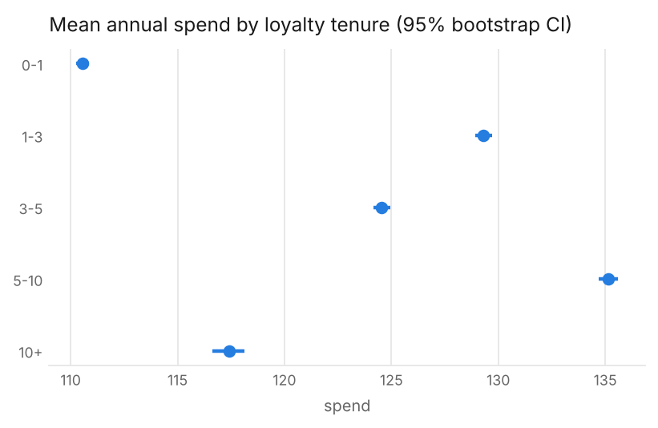
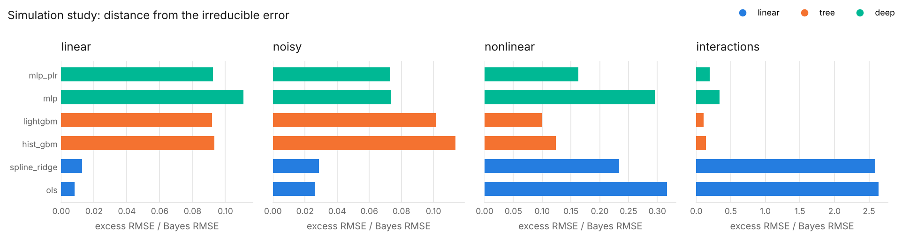
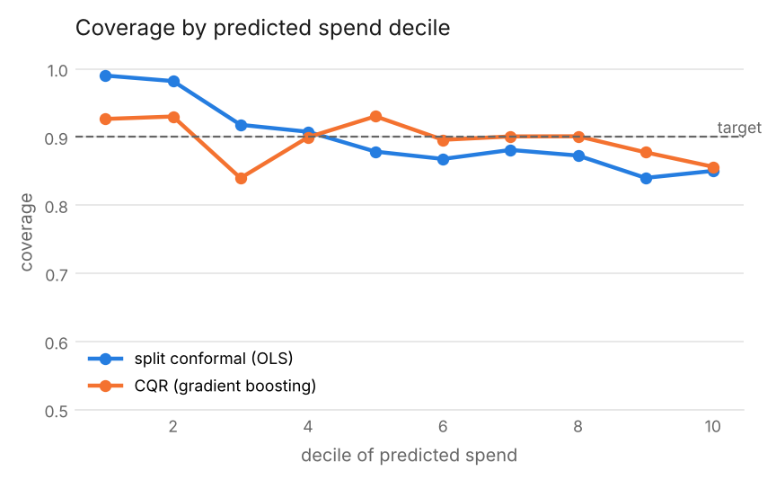

# Supermarket Loyalty: Spend Forecasting and Reward Cost Estimation

[](https://github.com/sahandyousefi/Supermarket-Loyalty-ML-Project/actions/workflows/ci.yml)


International Essentials, an international supermarket chain, pays loyalty rewards that grow with a member's annual spend. To budget for those rewards, the business needs a forecast of each member's spend, an honest statement of its uncertainty, and the resulting distribution of total reward cost.

This project answers that question end to end. It cleans and validates the raw extract, tests the business hypothesis that tenure drives spend, compares thirteen models from linear regression to an FT-Transformer under a common statistical protocol, uses a calibrated simulation study to show when each model family is worth its cost, builds distribution-free prediction intervals, and turns forecasts into a Monte Carlo estimate of reward cost. It started as a certification exercise (the original notebook is kept in `notebooks/`) and is now a tested Python package with a command line interface.

## Contents

- [Key findings](#key-findings)
- [Results](#results)
- [Approach](#approach)
- [Project structure](#project-structure)
- [Getting started](#getting-started)
- [Testing and CI](#testing-and-ci)
- [Limitations](#limitations)
- [References](#references)

## Key findings

1. **Tenure is the dominant driver of spend, but not monotonically.** In `loyalty.csv`, tenure band explains 88% of the variance accounted for by all features (Shapley decomposition of R squared). Welch's ANOVA gives F = 2506 on (4, 483) df with omega squared 0.885. Spend peaks in the 5-10 year band (mean 135.15) and falls for members of 10 years or more (117.41), so "longer tenure means higher spend" is not supported as stated.
2. **The supplied files cannot be joined.** `train.csv` and `loyalty.csv` share all customer ids, but region, tenure, joining month and promotion agree no more often than chance (Cohen's kappa between -0.004 and 0.052). Joining them on `customer_id` would silently corrupt every feature.
3. **On the supplied data, a linear model is the right choice.** OLS reaches a cross-validated RMSE of 0.308 against a target standard deviation of 26.8 (R squared 0.9999). Every non-linear model, including gradient boosting and three neural networks, is significantly worse (corrected resampled t-test, p < 0.001).
4. **Flexible models win only when the data demand them.** In a simulation calibrated to the real feature distribution, gradient boosting cuts the excess error over the irreducible noise from 2.6 times to 0.11 times the Bayes error once interactions are present. A plain MLP trails, and periodic numeric embeddings close most of that gap.
5. **Point forecasts misstate reward cost.** Rewards jump at tier thresholds, so the expected cost differs from the cost of the expected spend. For the 250 customers in `test.csv` the Monte Carlo forecast gives an expected total of 1,219.7 with a 90% interval of [1,215.3, 1,223.9], against 1,221.0 from plugging in point forecasts.

## Results

All figures below are produced by `loyalty-spend report`; the full tables are in [reports/results.md](reports/results.md).

### Spend by tenure (Task 2)

| Tenure | n | Mean spend | Variance | 95% bootstrap CI |
| --- | --- | --- | --- | --- |
| 0-1 | 382 | 110.56 | 9.30 | [110.26, 110.86] |
| 1-3 | 241 | 129.31 | 9.65 | [128.91, 129.72] |
| 3-5 | 256 | 124.55 | 11.09 | [124.15, 124.96] |
| 5-10 | 250 | 135.15 | 14.10 | [134.70, 135.61] |
| 10+ | 117 | 117.41 | 16.72 | [116.63, 118.12] |

All ten pairwise differences are significant under Tukey's HSD.

<p>
  
  
</p>

### Model comparison on train.csv (Tasks 3 and 4)

Five-fold cross-validation repeated three times, identical splits for every model.

| Model | Family | RMSE | MAE | Difference to OLS | p-value |
| --- | --- | --- | --- | --- | --- |
| OLS | linear | 0.308 (0.040) | 0.215 | | |
| Ridge | linear | 0.308 (0.040) | 0.215 | -0.000 | 0.85 |
| Huber | linear | 0.309 (0.041) | 0.213 | 0.001 | 0.68 |
| Spline ridge | linear | 0.310 (0.041) | 0.216 | 0.002 | 0.27 |
| Histogram GBM | tree | 0.433 (0.053) | 0.297 | 0.125 | < 0.001 |
| Elastic net | linear | 0.452 (0.042) | 0.322 | 0.144 | < 0.001 |
| MLP, periodic embeddings | deep | 0.454 (0.037) | 0.341 | 0.145 | < 0.001 |
| LightGBM | tree | 0.497 (0.055) | 0.350 | 0.189 | < 0.001 |
| MLP, entity embeddings | deep | 0.499 (0.065) | 0.372 | 0.190 | < 0.001 |
| FT-Transformer | deep | 0.555 (0.047) | 0.424 | 0.246 | < 0.001 |
| XGBoost | tree | 0.731 (0.078) | 0.513 | 0.423 | < 0.001 |
| Gamma GLM | linear | 1.081 (0.041) | 0.817 | 0.773 | < 0.001 |
| Random forest | tree | 2.173 (0.379) | 1.316 | 1.865 | < 0.001 |

Standard deviation across folds in parentheses; p-values from the corrected resampled t-test. The target is almost an exact linear function of tenure, joining month and first-month spend. Tree ensembles approximate the linear effect of first-month spend with steps, and networks fit it only approximately, so both pay a small but significant price. The Gamma GLM's log link imposes multiplicative effects where the true effects are additive.


### Simulation study

Because the real data are nearly noise free, they cannot show when a flexible model is worth its cost. The simulator resamples real feature rows, uses the OLS fit as the base signal and adds controlled departures. Each model's RMSE is compared with the known Bayes error (2,000 customers, 5-fold CV).

| Model | Linear | Noisy, heteroscedastic | Nonlinear | Interactions |
| --- | --- | --- | --- | --- |
| OLS | **1.352** | **5.629** | 1.766 | 4.883 |
| Spline ridge | 1.358 | 5.642 | 1.655 | 4.819 |
| Histogram GBM | 1.466 | 6.108 | 1.507 | 1.529 |
| LightGBM | 1.464 | 6.041 | **1.474** | **1.486** |
| MLP | 1.490 | 5.888 | 1.738 | 1.791 |
| MLP, periodic embeddings | 1.465 | 5.886 | 1.559 | 1.602 |
| Bayes error | 1.341 | 5.485 | 1.341 | 1.341 |

The ranking follows the data-generating process: OLS is within 1% of the Bayes error when the truth is linear, and LightGBM is within 11% when it is not. The plain MLP has difficulty with the step in first-month spend, a known weakness of networks biased towards smooth functions (Grinsztajn et al., 2022). Periodic embeddings of the numeric inputs (Gorishniy et al., 2022) cut its excess error by 42 to 45% in the nonlinear and interaction scenarios.



### Prediction intervals

Simulated heteroscedastic scenario, 90% target coverage, evaluated on 5,000 new customers.

| Method | Coverage | Mean width | Worst decile |
| --- | --- | --- | --- |
| Split conformal (OLS) | 0.899 | 17.4 | 0.840 |
| Conformalized quantile regression (gradient boosting) | 0.896 | 20.1 | 0.840 |

Both methods meet the marginal target. Split conformal uses one width for everyone, so it over-covers low spenders (99% in the lowest decile) and under-covers high spenders (84 to 85% in the top two deciles). CQR stays closer to the target in the upper deciles (88% and 86%) but dips to 84% in the third decile, and its intervals are wider, since its quantile models are fitted on only 1,500 rows. At this sample size and level of heteroscedasticity, neither method dominates.



### Reward cost

With the illustrative schedule in `configs/default.yaml` (2% from 100, 3% from 125, 5% from 140 of annual spend):

| Expected total | Plug-in total | 5th percentile | Median | 95th percentile |
| --- | --- | --- | --- | --- |
| 1,219.71 | 1,220.98 | 1,215.30 | 1,219.74 | 1,223.90 |

The distribution is lumpy because a handful of customers sit close to a tier threshold, and each of them moves the total by a discrete amount when they cross it. `loyalty-spend rewards` lists these customers with their probability of changing tier.


## Approach

Full notation, derivations and references are in [docs/methodology.md](docs/methodology.md); the model card is in [docs/model_card.md](docs/model_card.md).

**Data quality.** The raw extract is read as text so that placeholders survive parsing. In `loyalty.csv`, 125 values of `first_month` are the placeholder `.`, 125 joining months are empty and 125 promotion flags are upper case. The cleaning step applies the replacement rules of the data dictionary for Task 1 and logs every change. The models instead keep missing values missing and use median imputation with a missing-value indicator, because a recorded spend of zero and an unrecorded spend are different statements.

**Driver analysis.** Group means come with bootstrap intervals. Welch's ANOVA is used because group variances range from 9.3 to 16.7, effect sizes are reported as $\eta^2$ and $\omega^2$, and Tukey's HSD gives simultaneous pairwise intervals. Whether tenure is the *largest* driver is answered with the LMG decomposition, which attributes the full-model $R^2$ to features as Shapley values over all orders of entry:

$$\phi_j = \sum_{S \subseteq F\setminus\{j\}} \frac{|S|!\,(p-|S|-1)!}{p!}\big[R^2(S\cup\{j\}) - R^2(S)\big].$$

**Models.** Every model is a scikit-learn compatible estimator registered by name, so the CLI, the comparison and the tuner work with any of them.

| Family | Models |
| --- | --- |
| Linear | OLS, ridge (leave-one-out penalty), elastic net, Huber, Gamma GLM with log link, spline ridge (additive model) |
| Trees | Random forest, histogram gradient boosting with native categorical splits, XGBoost, LightGBM |
| Deep (PyTorch) | MLP with entity embeddings and residual blocks, MLP with periodic (PLR) numeric embeddings, FT-Transformer, deep ensemble of Gaussian MLPs |

The networks use embeddings for categories with a reserved index for unseen levels, AdamW, linear warmup and cosine decay, gradient clipping and early stopping on a validation split. The deep ensemble separates aleatoric from epistemic variance. Optuna's TPE sampler tunes hyperparameters, and nested cross-validation estimates the performance of the tuning procedure itself.

**Model comparison.** Fold scores on shared splits are paired but correlated through overlapping training sets, so differences are tested with the corrected resampled statistic of Nadeau and Bengio (2003):

$$t = \frac{\bar d}{\sqrt{\left(\frac1J + \frac{n_{\text{test}}}{n_{\text{train}}}\right)\hat\sigma_d^2}} \sim t_{J-1}.$$

**Uncertainty.** Split conformal prediction, CV+ (Barber et al., 2021) and conformalized quantile regression (Romano et al., 2019) give intervals with finite-sample coverage guarantees under exchangeability. Coverage is reported by decile of predicted spend as well as overall, since a correct average can hide systematic under-coverage of high spenders.

**Reward cost.** For each simulation draw $b$, spend is $\hat y_i + e^{(b)}_i$ with resampled out-of-fold residuals. The tier schedule is applied to every draw and the rewards are summed, which gives the distribution of total cost and each customer's probability of changing tier.

**Explainability.** Exact additive contributions for linear pipelines, TreeSHAP for tree ensembles (Lundberg et al., 2020) and permutation importance, all aggregated back to the raw features.

## Project structure

```
.
├── configs/default.yaml        paths, CV, network, reward and interval settings
├── data/raw/                   loyalty.csv, train.csv, test.csv (see data/README.md)
├── docs/                       methodology, model card
├── notebooks/                  original exam notebook
├── reports/                    results.md, summary.json and figures from a full run
├── src/loyalty_spend/
│   ├── cli.py                  loyalty-spend command
│   ├── config.py               typed YAML configuration
│   ├── tasks.py                the four deliverables of the brief
│   ├── data/                   schema, cleaning, IO, lineage check, simulator
│   ├── features/               preprocessing shared by all models
│   ├── analysis/               bootstrap, Welch ANOVA, Tukey HSD, LMG decomposition
│   ├── models/                 registry, linear, trees, tuning, persistence
│   │   └── deep/               encoder, MLP, PLR embeddings, FT-Transformer, training
│   ├── evaluation/             metrics, repeated CV, corrected t-test, simulation study
│   ├── uncertainty/            split conformal, CV+, CQR
│   ├── explain/                additive contributions, TreeSHAP, permutation importance
│   ├── business/               reward schedule and Monte Carlo cost forecast
│   └── reporting/              figures and the results report
└── tests/                      unit and integration tests
```

## Getting started

```bash
git clone https://github.com/sahandyousefi/Supermarket-Loyalty-ML-Project.git
cd Supermarket-Loyalty-ML-Project
pip install torch --index-url https://download.pytorch.org/whl/cpu   # optional, for the deep models
pip install -e ".[dev,all]"
```

The data are included, so every command runs without a download:

```bash
loyalty-spend tasks                                   # the four deliverables, written to artifacts/tasks
loyalty-spend clean --output clean.csv                # Task 1 with a change log
loyalty-spend drivers                                 # tenure analysis
loyalty-spend compare --models ols ridge lightgbm mlp_plr
loyalty-spend tune --model lightgbm --trials 50 --nested
loyalty-spend train --model ols
loyalty-spend predict data/raw/test.csv predictions.csv
loyalty-spend rewards data/raw/test.csv --output rewards.csv
loyalty-spend report                                  # full analysis, about 30 minutes on a laptop CPU
```

`docker build -t loyalty-spend .` builds an image that runs the same commands.

## Testing and CI

```bash
make lint
make test        # fast suite
make test-all    # includes network training and the simulation study
```

The tests check the cleaning rules against the data dictionary, Welch's ANOVA against SciPy's Welch t-test in the two-group case, LMG shares summing to $R^2$, the additivity of attributions, conformal coverage on simulated data, the Jensen gap in the reward forecast, reproducibility of network training and a full train, predict and rewards cycle through the CLI. GitHub Actions runs lint and the fast suite on Python 3.10 and 3.12.

## Limitations

- The data come from a certification exercise and are synthetic and nearly noise free. Results on `train.csv` describe that sample; the simulation study exists to compare methods under realistic noise.
- There is no time dimension, so validation is cross-sectional. A real deployment needs validation on a later programme year.
- The reward schedule is an assumption; the brief does not state the real one.
- Conformal coverage is marginal and assumes exchangeable customers. It does not hold after a change in the membership mix.
- The driver analysis is associational. It shows how spend differs across tenure bands, not what would happen to a member's spend if their tenure changed.

## References

- Barber, R. F., Candes, E. J., Ramdas, A., and Tibshirani, R. J. (2021). Predictive inference with the jackknife+. *Annals of Statistics*, 49(1), 486-507.
- Gorishniy, Y., Rubachev, I., Khrulkov, V., and Babenko, A. (2021). Revisiting deep learning models for tabular data. *NeurIPS*.
- Gorishniy, Y., Rubachev, I., and Babenko, A. (2022). On embeddings for numerical features in tabular deep learning. *NeurIPS*.
- Grinsztajn, L., Oyallon, E., and Varoquaux, G. (2022). Why do tree-based models still outperform deep learning on typical tabular data? *NeurIPS Datasets and Benchmarks*.
- Groemping, U. (2006). Relative importance for linear regression in R: The package relaimpo. *Journal of Statistical Software*, 17(1).
- Guo, C., and Berkhahn, F. (2016). Entity embeddings of categorical variables. *arXiv:1604.06737*.
- Lakshminarayanan, B., Pritzel, A., and Blundell, C. (2017). Simple and scalable predictive uncertainty estimation using deep ensembles. *NeurIPS*.
- Lundberg, S. M., et al. (2020). From local explanations to global understanding with explainable AI for trees. *Nature Machine Intelligence*, 2, 56-67.
- Nadeau, C., and Bengio, Y. (2003). Inference for the generalization error. *Machine Learning*, 52(3), 239-281.
- Romano, Y., Patterson, E., and Candes, E. J. (2019). Conformalized quantile regression. *NeurIPS*.
- Welch, B. L. (1951). On the comparison of several mean values: An alternative approach. *Biometrika*, 38(3/4), 330-336.

## License

MIT. See [LICENSE](LICENSE).
