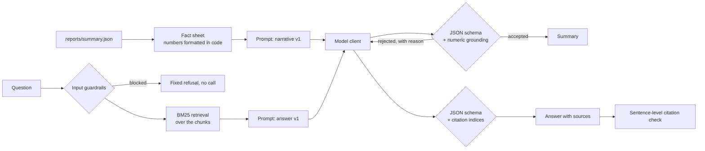

# Language model components

Two commands use a language model: `loyalty-spend narrate` turns the report into a short summary for a programme manager, and `loyalty-spend ask` answers questions about the project from its documentation. Both are designed around one rule: **the model writes sentences, the code supplies every number and every source.** Both run without a model (offline mode prints the fact sheet or the retrieved passages), so nothing in the analysis depends on one.

## Architecture

## Components

| Module | Role |
| --- | --- |
| `llm/client.py` | `LLMClient` protocol, a deterministic `MockLLM` for tests, and an HTTP client for any chat completions server with retries on 429 and 5xx. Configured by `LLM_BASE_URL`, `LLM_MODEL` and `LLM_API_KEY`; the key is never logged. |
| `llm/prompts/*.yaml` | Prompt templates with a version number that is recorded with every output. |
| `llm/facts.py` | Builds one sentence per fact from `summary.json`, with numbers already rounded, so the model never computes. |
| `llm/grounding.py` | Extracts every number from generated text and rejects numbers absent from the facts. Percentages and plain numbers are kept apart; thousands separators are ignored. |
| `llm/structured.py` | Accepts a reply only if it is a JSON object with the required keys and types and passes the content validator; otherwise asks again once with the reason, then raises. |
| `llm/corpus.py`, `llm/retrieval.py` | Splits the Markdown documentation at headings and paragraphs into chunks of at most 180 words, indexes them with Okapi BM25 over unigrams; a TF-IDF index over unigrams and bigrams is kept for comparison. |
| `llm/qa.py`, `llm/citations.py` | Answers from numbered passages and checks each sentence against the passages it cites: all numbers must occur there and at least half of the content words. |
| `llm/guardrails.py` | Normalises the question (NFKC, control characters removed), limits its length and blocks common instruction-override phrasings before any call. |
| `llm/reasons.py` | Explains a single forecast from the exact additive contributions of the linear model; a template gives the same content without a model. |
| `llm/evaluation.py`, `llm/usage.py` | Evaluation harness and token, latency and cost accounting. |

## Evaluation

Retrieval is measured on 12 questions with known answering sections (`llm/eval/retrieval.yaml`), over 115 chunks:

| Metric | TF-IDF | BM25 (default) |
| --- | --- | --- |
| Recall at 1 | 0.417 | 0.500 |
| Recall at 5 | 0.750 | 0.917 |
| Mean reciprocal rank | 0.563 | 0.683 |

TF-IDF reached a recall at 5 of 0.833 on the 91 chunks of the first release; as the robustness and synthetic data sections were added, long sections that mention Gower distance in passing pushed the segment section out of the top five. BM25 (Robertson and Zaragoza, 2009) saturates repeated terms and compares each chunk with the average length, which brings it back, and it also finds the model comparison test. The parameters are the textbook defaults ($k_1 = 1.2$, $b = 0.75$), not values tuned on the evaluation questions. With four passages per question, the answering section reaches the model for 10 of the 12 questions. The question about the service endpoints is still missed, because it is asked in words that do not appear in that section; dense retrieval or query expansion would be the next step if the corpus grows.

The answer harness (`llm/eval/qa.yaml`, 12 answerable, 4 unanswerable and 3 hostile questions) reports format compliance, answer rate, correct refusals, faithfulness (share of answers whose every sentence passes the citation check) and the retrieval hit rate. CI runs it against the mock client, which tests the harness and the checks, not a model. Scores for a real model come from running the same harness with `LLM_BASE_URL` set; none are reported here because none were run for this release.

## Failure modes and what catches them

| Failure | Defence |
| --- | --- |
| Invented or recomputed number in a summary | Numeric grounding rejects the reply and asks again with the offending numbers |
| Malformed reply | Schema check and a bounded retry, then an explicit error |
| Citation to a passage that was not shown | Index check in the validator |
| Citation to a passage that does not support the sentence | Sentence-level check, reported as unverified |
| Question that tries to override the instructions | Guardrails before the call; the prompt also declares passages to be data |
| Question outside the documentation | Fixed refusal sentence, counted by the harness |

The lexical checks are strict and will flag correct paraphrases; they are meant to route answers to a person, not to certify them.

## References

- Robertson, S., and Zaragoza, H. (2009). The probabilistic relevance framework: BM25 and beyond. *Foundations and Trends in Information Retrieval*, 3(4), 333-389.
